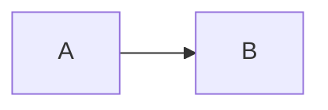

# Fixture Cover

<LightOrDark>
  <template #dark>Dark only</template>
  <template #light>Light only</template>
</LightOrDark>

---

# Lists

<ol start="3" style="list-style: decimal">
  <li>Third</li>
  <li>Fourth</li>
</ol>

<ul class="arrows">
  <li>Arrow one</li>
  <li>Arrow two</li>
</ul>

<ul style="list-style: square">
  <li>Square</li>
</ul>

<ol style="list-style-type: lower-alpha">
  <li v-click>Alpha</li>
  <li v-click>Beta</li>
</ol>

---

# Colors and Units

<span class="chip">hsl chip</span>

<div class="ok"></div>
<div class="named"></div>
<div class="mix"></div>
<p class="layered">Layered: lime</p>
<p class="layer-loses">Unlayered: teal</p>

---
transition: slide-left
---

# Pseudo Content

<p class="tag">Starred</p>

<div class="box">Boxed by ::after</div>

---
layout: image-right
image: /photo.png
transition: none
---

# Images


---

# Code and Shapes

```ts
const first = 1;

const second = 2;
```

Read the [Slidev docs](https://sli.dev).

<svg class="ring" width="60" height="60" viewBox="0 0 60 60"><circle cx="30" cy="30" r="20" fill="none" stroke="tomato" stroke-width="4" /></svg>

<div class="gradient"></div>
<div v-click class="faint"></div>
<p class="invisible">Invisible text</p>


<!--
Notes with *emphasis*, **bold**, and `code`.

A second paragraph.
-->

---

# Embeds

<iframe src="https://example.com/embed"></iframe>
<video src="/clip.mp4"></video>
<Unregistered />

```ts {monaco-diff}
const side = "original";
~~~
const side = "modified";
```

```ts {monaco-run}
console.log("ran");
```



---
dragPos:
  named: 200,300,120,30
---

# Directives

<span v-mark.circle="{ at: 1 }">Marked</span>

<div v-motion :initial="{ x: -80 }" :enter="{ x: 0 }">Moving</div>

<div v-drag="[40, 300, 120, 30]">Dragged</div>

<div v-drag="'named'">Named</div>

---

# Switch and Gap

<v-switch>
  <template #1>Switched one</template>
  <template #2>Switched two</template>
</v-switch>

<v-click-gap size="2" />

<div v-click>After the gap</div>

<span v-if="$clicks > 4" v-mark="{ at: 1 }">Marked later</span>

---
clicksStart: 1
---

# Highlighted Math

$$ {1|2}
\begin{array}{c}
a \\
b
\end{array}
$$

---
class: nested-lists
---

# Nested Lists

- Parent
  - Child
- **Term**: description
  - Sub item

1. First
   - Inner
2. Second

- Loose one

- Loose two

<ul class="unmarked"><li class="own-marker">Own marker</li></ul>

---

# Inline Content <svg class="icon" width="16" height="16" viewBox="0 0 16 16"><path d="M0 0h16v16H0z" fill="tomato" /></svg>

<p>x&nbsp;&nbsp;&nbsp;y</p>
<p>H<sub>2</sub>O</p>
<p>Shown<span class="clipped">Clipped away</span></p>
<div class="dark-text"><p class="unparsed-color">Parent color</p></div>
<p class="glow">Glow</p>
<div class="percent-parent"><p class="percent-padding">Percent padding</p></div>

---

# Shapes and Backgrounds

<svg aria-label="Shapes" width="120" height="60" viewBox="0 0 120 60"><ellipse cx="30" cy="30" rx="30" ry="15" fill="tomato" opacity="0.5" /><g fill="teal"><polygon points="70,0 110,0 90,40" /></g></svg>
<svg aria-label="Turned" width="60" height="60" viewBox="0 0 60 60"><polygon points="0,0 40,0 20,40" fill="teal" transform="rotate(10)" /></svg>

<div class="radial">Radial</div>
<div class="tiled">Tiled</div>

<div class="card"><h3>Card title</h3><p>Card body</p></div>

---

# Click Order

<div v-click>Outer<div v-click>Inner</div></div>

<v-clicks depth="2">

- One
  - One a
- Two

</v-clicks>

<div v-click.fade>Faded</div>

<div v-click.hide>Hidden</div>

<div v-click="[1, 2]">Ranged</div>

<div v-click="false">Unclicked</div>

---

# Code Blocks

<CodeGroup>

```ts [first.ts]
const first = 1;
```

```ts [second.ts]
const second = 2;
```

</CodeGroup>

```ts {1|hide}
const highlighted = 1;
const dishonored = 2;
```

```ts {monaco}
const edited = 1;
```

```ts twoslash
const hovered = 1;
//    ^?
```

````md magic-move
```ts
const before = 1;
```
```ts
const after = 1;
```
````

---

# Text Effects

<p class="gradient-text">Gradient text</p>

<p>First line<br>Second line</p>

<svg aria-label="Labeled" width="120" height="40" viewBox="0 0 120 40"><defs><linearGradient id="fade"><stop offset="0" stop-color="red" /><stop offset="1" stop-color="blue" /></linearGradient></defs><polygon points="0,0 120,0 120,16 0,16" fill="url(#fade)" /><text x="0" y="36" fill="teal">SVG label</text></svg>

<div class="columns"><p>Left column</p><p>Right column</p></div>

---

# Missing Image


---

# Wrapped Code

<v-click>

```ts {1|2|3}
const one = 1;
const two = 2;
const three = 3;
```

</v-click>

<div v-click>After the code</div>

<v-click>

```ts {monaco}
const wrapped = 1;
```

</v-click>

---
clicksStart: 2
---

# Started Late

<p>Shown from the start</p>

---

# Deck Setup

<RegisteredInSetup />

<p class="themed">Themed</p>

<span v-tooltip="'A tip'">Tipped</span>

---

# Late Failure

<FailsOnClick :clicks="$clicks" />

<div v-click>Clicked</div>

---

# Navigation

<Toc mode="onlyCurrentTree" />

<Link to="2">Go to Lists</Link>
