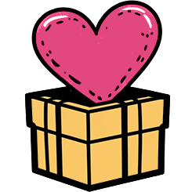

# Fixture Cover

A dimmed background image

---

# Lists

<ol start="3">
  <li>Third</li>
  <li>Fourth</li>
</ol>

<ul class="arrows">
  <li>Arrow one</li>
  <li>Arrow two</li>
</ul>

<ul style="list-style: square">
  <li>Square</li>
</ul>

<ol style="list-style-type: lower-alpha">
  <li v-click>Alpha</li>
  <li v-click>Beta</li>
</ol>

---

# Colors and Units

hsl chip

Layered: lime

Unlayered: teal

---
transition: slide-left
---

# Pseudo Content

Starred

Boxed by ::after

---
layout: image-right
image: /photo.png
transition: none
---

# Images

---

# After None

The slide before this one plays no transition into it.
